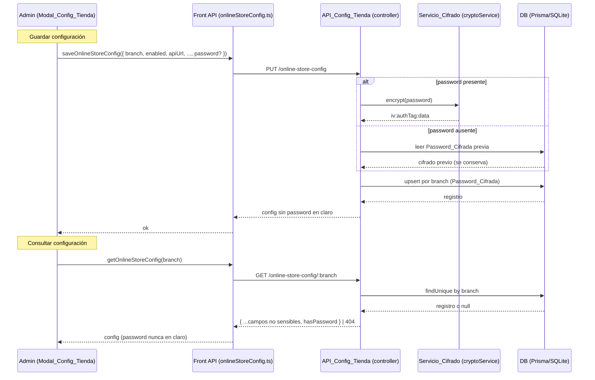
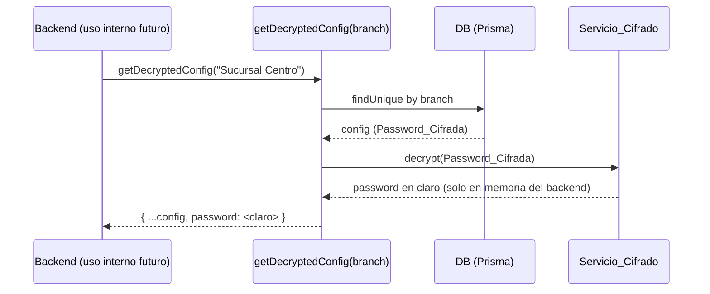

# Documento de Diseño

## Overview

Esta feature introduce un módulo de **configuración de tienda online por sucursal** que reemplaza los valores fijos hoy escritos en el código del frontend (la URL del API en `onlineStoreOrders.ts` y las credenciales en `OnlineStoreModal.tsx`). La sucursal no es una entidad con identificador propio: es el texto `branch` que cada terminal guarda en `localStorage` bajo la clave `sucursal`, y actúa como clave única de la configuración.

El diseño toca cuatro capas:

1. **Esquema de datos (Prisma)**: un nuevo modelo `OnlineStoreConfig` con `branch` como clave única, `enabled` con valor por defecto `false`, la URL del API, el nombre de la tienda, el usuario, la contraseña (cifrada) y los endpoints de productos y ventas. Se aplica con `prisma db push` y solo tras confirmación explícita del usuario (historial de migraciones no reproducible).
2. **Servicio de cifrado (backend)**: un `cryptoService` nuevo en `src/services/` que cifra y descifra la contraseña con AES-256-GCM usando una clave de variable de entorno (`ONLINE_STORE_CRYPTO_KEY`). La contraseña se persiste cifrada y nunca se devuelve en claro al frontend.
3. **API de configuración (`onlineStoreConfigController`)**: una consulta por sucursal (con contraseña enmascarada/ausente) y un `upsert` que crea o actualiza por `branch`, cifrando la contraseña cuando viene y conservando la previa cuando no. Un helper interno `getDecryptedConfig(branch)` permite al propio backend usar la contraseña descifrada sin exponerla.
4. **Frontend (React/Electron)**: un módulo de API tipado (`onlineStoreConfig.ts`), un **Modal_Config_Tienda** accesible desde el menú de administración del POS, y un **hook de lectura** (`useOnlineStoreConfig`) que carga la config de la sucursal actual y gobierna la visibilidad del botón "Cobrar en línea" y del acceso al módulo de tienda online, además de alimentar la URL y las credenciales que antes eran fijas.

### Principio rector de la decisión de diseño

El problema de raíz es un **acoplamiento entre "configuración" y "código"**: hoy la URL y las credenciales están fijas en el binario, idénticas para todas las terminales, y solo cambian recompilando. La solución **externaliza la configuración a datos por sucursal** y la **centraliza en una sola fuente de verdad** (`OnlineStoreConfig`), de modo que la UI pasa de leer constantes a leer configuración resuelta en tiempo de ejecución. La contraseña, por ser un secreto, nunca sale del backend en claro: se cifra al entrar y solo se descifra de forma interna cuando el propio backend la necesita.

Un segundo principio es la **degradación segura por defecto**: la ausencia de configuración (o `enabled = false`) no es un error, es un estado válido que **oculta** por completo las funciones de tienda online. La visibilidad es una función pura de un único predicado: *existe config y está habilitada*.

### Archivos afectados

| Capa | Archivo | Cambio |
|------|---------|--------|
| Datos | `mariam-pos-backend/prisma/schema.prisma` | Nuevo modelo `OnlineStoreConfig` |
| Servicio | `mariam-pos-backend/src/services/cryptoService.js` (nuevo) | `encrypt` / `decrypt` AES-256-GCM |
| API | `mariam-pos-backend/src/controllers/onlineStoreConfigController.js` (nuevo) | `getOnlineStoreConfig`, `upsertOnlineStoreConfig`, `getDecryptedConfig` |
| API | `mariam-pos-backend/src/routes/onlineStoreConfig.js` (nuevo) | Rutas GET y PUT/POST (upsert) |
| API | `mariam-pos-backend/src/index.js` (o el agregador de rutas) | Registrar el router de config |
| Front API | `mariam-pos-front/src/api/onlineStoreConfig.ts` (nuevo) | Tipos + `getOnlineStoreConfig`, `saveOnlineStoreConfig` |
| Front hook | `mariam-pos-front/src/hooks/useOnlineStoreConfig.ts` (nuevo) | Carga la config de la sucursal y expone visibilidad/credenciales/endpoints |
| Front UI | `mariam-pos-front/src/pages/.../OnlineStoreConfigModal.tsx` (nuevo) | Modal de configuración con design tokens |
| Front UI | `mariam-pos-front/src/pages/sales/salesPage.tsx` | Propaga visibilidad al Footer; abre el modal de config |
| Front UI | `mariam-pos-front/src/pages/sales/Footer.tsx` | Oculta "Cobrar en línea" según la config |
| Front UI | `mariam-pos-front/src/pages/.../POSPage.tsx` | Oculta el acceso al módulo de tienda; acceso al modal de config |
| Front | `mariam-pos-front/src/api/onlineStoreOrders.ts` | La URL deja de ser constante fija; se resuelve desde la config |
| Front | `mariam-pos-front/src/components/OnlineStoreModal.tsx` | Credenciales de login desde la config, no fijas |

## Architecture

### Flujo de configuración (guardado y consulta)



### Uso interno de la contraseña descifrada



`getDecryptedConfig` es un helper **interno**: no se expone en ninguna ruta HTTP. Es el único punto donde la contraseña vuelve a claro, y ocurre dentro del proceso backend.

### Decisión clave: dónde vive el cifrado y el enmascarado

El cifrado y el enmascarado viven **enteramente en el backend**, nunca en el frontend. El frontend solo maneja la contraseña en claro cuando el administrador la escribe (write-only) y la envía una vez; nunca la recibe de vuelta. Esto garantiza el invariante central (la contraseña en claro no sale del backend) independientemente de cómo evolucione la UI.

**Alternativa descartada**: cifrar en el frontend y enviar ya cifrado. Se descartó porque obligaría a distribuir la `Clave_Cifrado` al cliente (Electron), lo que anula la protección: cualquiera con acceso al bundle tendría la clave. Mantener la clave solo en el entorno del backend es la única forma de que el secreto sea realmente secreto.

### Decisión clave: AES-256-GCM y formato del valor cifrado

Se usa **AES-256-GCM** (cifrado autenticado) en lugar de CBC. GCM aporta integridad: si el texto cifrado se altera, el descifrado falla en vez de devolver basura. El valor persistido tiene el formato de tres segmentos separados por `:`, todos en `base64` / `hex`:

```
<iv>:<authTag>:<data>
```

- `iv`: vector de inicialización aleatorio de 12 bytes, generado por operación de cifrado (nunca reutilizado).
- `authTag`: etiqueta de autenticación de 16 bytes que produce GCM.
- `data`: texto cifrado.

La `Clave_Cifrado` (`ONLINE_STORE_CRYPTO_KEY`) se deriva a 32 bytes (p. ej. `scrypt`/`sha256` de la variable de entorno) para cumplir el tamaño de clave de AES-256. Si la variable no está definida, cualquier operación de cifrado o descifrado se rechaza con un error descriptivo **antes** de tocar la base de datos.

### Decisión clave: resolución de la URL sin romper el cliente axios

`onlineStoreOrders.ts` hoy crea su cliente axios con una `baseURL` constante. Para no reescribir ese cliente ni romper las llamadas existentes, se adopta **resolución por setter + lectura diferida**:

- Se expone un setter `setOnlineStoreApiBaseUrl(url)` que actualiza la `baseURL` del cliente axios existente (`instance.defaults.baseURL = url`).
- El hook `useOnlineStoreConfig`, al cargar la config de la sucursal, invoca ese setter una vez que conoce `apiUrl`.
- Las rutas de productos/ventas se resuelven leyendo `productsEndpoint`/`salesEndpoint` de la config en el momento de la llamada, no en tiempo de módulo.

Así el cliente axios y su firma de funciones no cambian; solo deja de depender de una constante de tiempo de módulo.

**Alternativa descartada**: recrear la instancia axios en cada render. Se descartó por el costo y por romper interceptores/estado ya configurados en la instancia actual.

## Components and Interfaces

### Backend — `cryptoService.js` (Servicio_Cifrado)

```js
// src/services/cryptoService.js (ESM)
import crypto from "node:crypto";

const ALGORITHM = "aes-256-gcm";
const IV_BYTES = 12;

function getKey() {
  const raw = process.env.ONLINE_STORE_CRYPTO_KEY;
  if (!raw || raw.trim() === "") {
    const err = new Error(
      "ONLINE_STORE_CRYPTO_KEY no está definida: no es posible cifrar ni descifrar credenciales de tienda online."
    );
    err.statusCode = 500;
    throw err;
  }
  // Deriva 32 bytes para AES-256 de forma determinista.
  return crypto.createHash("sha256").update(raw).digest();
}

// encrypt(plain) -> "iv:authTag:data" (Req 2.1)
export function encrypt(plain) {
  const key = getKey();
  const iv = crypto.randomBytes(IV_BYTES);
  const cipher = crypto.createCipheriv(ALGORITHM, key, iv);
  const data = Buffer.concat([cipher.update(String(plain), "utf8"), cipher.final()]);
  const authTag = cipher.getAuthTag();
  return [iv.toString("base64"), authTag.toString("base64"), data.toString("base64")].join(":");
}

// decrypt(cipherText) -> plain (Req 2.2); lanza si el formato o la clave son inválidos (Req 2.4)
export function decrypt(cipherText) {
  const key = getKey();
  const [ivB64, tagB64, dataB64] = String(cipherText).split(":");
  if (!ivB64 || !tagB64 || !dataB64) {
    const err = new Error("Formato de credencial cifrada inválido.");
    err.statusCode = 500;
    throw err;
  }
  const decipher = crypto.createDecipheriv(ALGORITHM, key, Buffer.from(ivB64, "base64"));
  decipher.setAuthTag(Buffer.from(tagB64, "base64"));
  const out = Buffer.concat([decipher.update(Buffer.from(dataB64, "base64")), decipher.final()]);
  return out.toString("utf8");
}
```

Nota: `getKey()` se evalúa en cada operación, de modo que la ausencia de clave se detecta en el momento de uso y no al cargar el módulo (Req 2.3, 2.4).

### Backend — `onlineStoreConfigController.js` (API_Config_Tienda)

```js
// src/controllers/onlineStoreConfigController.js (ESM)
import prisma from "../utils/prisma.js";
import { encrypt, decrypt } from "../services/cryptoService.js";

// Campos no sensibles que SÍ se devuelven al frontend (Req 3.1)
const PUBLIC_FIELDS = [
  "branch", "enabled", "apiUrl", "storeName",
  "username", "productsEndpoint", "salesEndpoint",
  "createdAt", "updatedAt",
];

function toPublicConfig(record) {
  const out = {};
  for (const f of PUBLIC_FIELDS) out[f] = record[f];
  // La contraseña nunca en claro: se indica solo su presencia (Req 2.5, 3.2)
  out.hasPassword = Boolean(record.password);
  return out;
}

// GET /online-store-config/:branch  (o ?branch=)
export async function getOnlineStoreConfig(req, res) {
  const branch = req.params.branch ?? req.query.branch;
  if (!branch) {
    return res.status(400).json({ error: "El parámetro 'branch' es obligatorio." });
  }
  const record = await prisma.onlineStoreConfig.findUnique({ where: { branch } });
  if (!record) {
    // Ausencia de configuración, estructura clara (Req 3.3)
    return res.status(404).json({ exists: false, branch, message: "Sin configuración para la sucursal." });
  }
  return res.json({ exists: true, ...toPublicConfig(record) }); // Req 3.1, 3.4
}

// PUT/POST /online-store-config  (upsert por branch) (Req 4)
export async function upsertOnlineStoreConfig(req, res) {
  const { branch, enabled, apiUrl, storeName, username,
          password, productsEndpoint, salesEndpoint } = req.body ?? {};

  if (!branch) { // Req 4.5
    return res.status(400).json({ error: "El campo 'branch' es obligatorio." });
  }

  const data = {
    enabled: typeof enabled === "boolean" ? enabled : undefined,
    apiUrl, storeName, username, productsEndpoint, salesEndpoint,
  };

  // Password write-only: cifrar si viene; conservar la previa si no (Req 4.3, 4.4)
  if (password !== undefined && password !== null && String(password) !== "") {
    data.password = encrypt(password);
  }

  const record = await prisma.onlineStoreConfig.upsert({
    where: { branch },                          // Req 1.2 (clave única)
    update: data,                               // Req 4.2
    create: { branch, ...data },                // Req 4.1 (enabled -> default false por el esquema, Req 1.3)
  });

  return res.json({ exists: true, ...toPublicConfig(record) }); // nunca password en claro (Req 2.5)
}

// Helper INTERNO (no expuesto en rutas): entrega la config con password descifrada (Req 2.2)
export async function getDecryptedConfig(branch) {
  const record = await prisma.onlineStoreConfig.findUnique({ where: { branch } });
  if (!record) return null;
  return {
    ...record,
    password: record.password ? decrypt(record.password) : null,
  };
}
```

> Sobre el `upsert` sin password: cuando `password` no viene, `data.password` queda `undefined`, y Prisma **no modifica** la columna en `update`, conservando la `Password_Cifrada` previa (Req 4.4). En `create`, la ausencia de password deja el campo nulo (config nueva sin credencial aún).

### Backend — rutas

```js
// src/routes/onlineStoreConfig.js (ESM)
import { Router } from "express";
import { getOnlineStoreConfig, upsertOnlineStoreConfig } from "../controllers/onlineStoreConfigController.js";

const router = Router();

router.get("/:branch", getOnlineStoreConfig); // Req 3 (también admite ?branch= si se omite el param)
router.put("/", upsertOnlineStoreConfig);      // Req 4 (upsert)
router.post("/", upsertOnlineStoreConfig);     // alias POST para el mismo upsert

export default router;
```

`getDecryptedConfig` **no** se enruta: es un import interno para uso del propio backend.

### Frontend — API (`onlineStoreConfig.ts`)

```ts
// src/api/onlineStoreConfig.ts
export interface OnlineStoreConfig {
  branch: string;
  enabled: boolean;
  apiUrl: string | null;
  storeName: string | null;
  username: string | null;
  productsEndpoint: string | null;
  salesEndpoint: string | null;
  hasPassword: boolean;      // indica si hay credencial guardada (nunca el valor)
  createdAt?: string;
  updatedAt?: string;
}

// Payload de guardado. La contraseña es write-only y opcional:
// si se omite, el backend conserva la previa (Req 4.4 / 5.6).
export interface OnlineStoreConfigPayload {
  branch: string;
  enabled: boolean;
  apiUrl?: string | null;
  storeName?: string | null;
  username?: string | null;
  password?: string;         // solo se envía cuando el admin la escribe
  productsEndpoint?: string | null;
  salesEndpoint?: string | null;
}

// Devuelve null cuando no existe configuración para la sucursal (404 -> null) (Req 3.3)
export const getOnlineStoreConfig = async (
  branch: string
): Promise<OnlineStoreConfig | null> => { /* GET /online-store-config/:branch */ };

export const saveOnlineStoreConfig = async (
  payload: OnlineStoreConfigPayload
): Promise<OnlineStoreConfig> => { /* PUT /online-store-config (upsert) */ };
```

La interfaz `OnlineStoreConfig` **no tiene** campo `password`: la contraseña nunca se recibe del GET (Req 2.5, 3.2, 5.4).

### Frontend — hook de lectura (`useOnlineStoreConfig.ts`)

```ts
// src/hooks/useOnlineStoreConfig.ts
import { setOnlineStoreApiBaseUrl } from "../api/onlineStoreOrders";

export interface OnlineStoreRuntime {
  loading: boolean;
  config: OnlineStoreConfig | null;
  // Visibilidad: true sii existe config y enabled === true (Req 6.4, 7.*)
  isOnlineStoreVisible: boolean;
  // Credenciales para login contra la tienda (username desde config; password la escribe el flujo de login) (Req 6.2)
  username: string | null;
  apiUrl: string | null;          // Req 6.1
  productsEndpoint: string | null; // Req 6.3
  salesEndpoint: string | null;    // Req 6.3
  reload: () => void;
}

export function useOnlineStoreConfig(): OnlineStoreRuntime {
  const branch = localStorage.getItem("sucursal") ?? "";
  // 1. getOnlineStoreConfig(branch) -> config | null
  // 2. isOnlineStoreVisible = Boolean(config) && config.enabled === true
  // 3. si config?.apiUrl -> setOnlineStoreApiBaseUrl(config.apiUrl) (propagación al cliente axios)
  // 4. expone apiUrl / endpoints / username
  // ...
}
```

Predicado único de visibilidad (fuente de verdad para Req 6.4 y todo el Req 7):

```ts
export const computeOnlineStoreVisible = (config: OnlineStoreConfig | null): boolean =>
  Boolean(config) && config!.enabled === true;
```

### Frontend — `OnlineStoreConfigModal.tsx` (Modal_Config_Tienda)

```tsx
// Estética con design tokens (var(--modal-*)), misma línea que
// RecoverContainersModal / AccountsReceivableModal.
// Lee la sucursal de la terminal actual (Req 5.2).
const branch = localStorage.getItem("sucursal") ?? "";

// Al abrir: getOnlineStoreConfig(branch) y precargar campos no sensibles (Req 5.3).
// El campo password arranca VACÍO aunque exista config (write-only) (Req 5.4).
const [form, setForm] = useState({
  enabled: false, apiUrl: "", storeName: "", username: "",
  password: "",                 // write-only; vacío = no cambiar (Req 5.6)
  productsEndpoint: "", salesEndpoint: "",
});

// Campos del formulario:
// - switch "Tienda online habilitada" -> enabled
// - apiUrl, storeName, username
// - password (type="password", placeholder "Dejar vacío para conservar la actual")
// - productsEndpoint, salesEndpoint
// - botón Guardar

async function handleSave() {
  const payload: OnlineStoreConfigPayload = {
    branch,
    enabled: form.enabled,
    apiUrl: form.apiUrl || null,
    storeName: form.storeName || null,
    username: form.username || null,
    productsEndpoint: form.productsEndpoint || null,
    salesEndpoint: form.salesEndpoint || null,
  };
  // Solo adjunta password si el admin la escribió (Req 5.5, 5.6)
  if (form.password.trim() !== "") payload.password = form.password;
  await saveOnlineStoreConfig(payload); // upsert para la sucursal actual (Req 5.5)
}
```

**Acceso (Req 5.1)**: el acceso al Modal_Config_Tienda se agrega como ítem del menú de administración del POS en `POSConfigModal` (si existe ese agrupador de ajustes) o, en su defecto, como un ítem de ajustes en `POSPage.tsx`. El acceso al modal de **configuración** es independiente de la visibilidad del módulo de tienda: el administrador siempre puede entrar a configurar, incluso cuando la tienda está deshabilitada u sin configurar.

### Frontend — integración de visibilidad y reemplazo de valores fijos

```tsx
// POSPage.tsx
const { isOnlineStoreVisible } = useOnlineStoreConfig();
// Acceso_Modulo_Tienda (abre OnlineStoreModal) se renderiza solo si isOnlineStoreVisible (Req 7.2, 7.4, 7.5)
{isOnlineStoreVisible && <OnlineStoreAccessButton onClick={openOnlineStoreModal} />}

// salesPage.tsx -> Footer.tsx
// showOnlineSales se deriva de la config, no de un valor fijo (Req 7.1, 7.3, 7.5)
<Footer showOnlineSales={isOnlineStoreVisible} /* ... */ />
```

```ts
// onlineStoreOrders.ts — la URL deja de ser constante fija (Req 6.1)
// Antes: const ONLINE_STORE_API_URL = "https://.../"  (hardcode eliminado)
// Ahora: setter que actualiza la baseURL del cliente axios existente.
let currentBaseUrl: string | null = null;
export const setOnlineStoreApiBaseUrl = (url: string | null) => {
  currentBaseUrl = url;
  instance.defaults.baseURL = url ?? undefined; // no se recrea la instancia
};
// Las rutas de productos/ventas se leen de la config (productsEndpoint/salesEndpoint) en cada llamada (Req 6.3).
```

```tsx
// OnlineStoreModal.tsx — credenciales de login desde la config, no fijas (Req 6.2)
// Antes: DEFAULT_ONLINE_STORE_EMAIL / DEFAULT_ONLINE_STORE_PASSWORD (hardcodes eliminados)
const { username } = useOnlineStoreConfig();
// El login usa `username` de la config; la contraseña se obtiene del flujo seguro del backend
// (el front no recibe la contraseña en claro desde el GET).
```

## Data Models

### `OnlineStoreConfig` (nuevo)

```prisma
model OnlineStoreConfig {
  id   Int    @id @default(autoincrement())

  // Clave única por sucursal: a lo sumo una config por branch (Req 1.1, 1.2)
  branch String @unique

  // Habilitación; por defecto deshabilitada (Req 1.3)
  enabled Boolean @default(false)

  // Datos de conexión de la tienda online (Req 1.1)
  apiUrl           String?
  storeName        String?
  username         String?

  // Contraseña almacenada SIEMPRE cifrada (Password_Cifrada) (Req 1.4, 2.1)
  // Formato: "iv:authTag:data" (AES-256-GCM)
  password         String?

  // Endpoints de productos y ventas (Req 1.1)
  productsEndpoint String?
  salesEndpoint    String?

  createdAt DateTime @default(now())
  updatedAt DateTime @updatedAt

  @@index([branch])
}
```

Notas de modelado:

- `branch` es `String @unique`: refleja que la sucursal es un texto (el mismo valor de `localStorage.sucursal`) y garantiza unicidad a nivel de base de datos (Req 1.2).
- `enabled Boolean @default(false)`: una config recién creada que no especifica `enabled` queda deshabilitada, cumpliendo la degradación segura por defecto (Req 1.3).
- `password` es `String?` y **solo** guarda el texto cifrado en formato `iv:authTag:data`. La base de datos nunca contiene la contraseña en claro (Req 1.4).
- Todos los campos de datos son opcionales salvo `branch`: se puede guardar una configuración parcial (p. ej. habilitar más tarde, o cargar credenciales en una edición posterior).

### Aplicación del esquema (Req 1.5)

El cambio se aplica con:

```
npx prisma db push
```

**No** se usa `prisma migrate dev` (historial de migraciones no reproducible en el proyecto). La ejecución se realiza **solo tras confirmación explícita del usuario**. Antes de aplicar, se recomienda respaldar el archivo SQLite. Como el modelo es nuevo y no altera tablas existentes, el `db push` solo agrega la tabla `OnlineStoreConfig` sin tocar datos previos.

### Variable de entorno requerida

```
# .env del backend
ONLINE_STORE_CRYPTO_KEY=<secreto de alta entropía>
```

El Servicio_Cifrado deriva de esta variable una clave AES-256 de 32 bytes. Su ausencia bloquea cifrado y descifrado con un error descriptivo (Req 2.3, 2.4), pero **no** impide consultar la config (el GET no descifra nada).

## Correctness Properties

*Una propiedad es una característica o comportamiento que debe cumplirse en todas las ejecuciones válidas del sistema: es una afirmación formal sobre lo que el sistema debe hacer. Las propiedades son el puente entre la especificación legible por humanos y las garantías de corrección verificables por máquina.*

El núcleo de esta feature —el cifrado reversible, el enmascarado de la respuesta, la semántica del upsert, el filtrado por sucursal, la resolución de configuración y el predicado de visibilidad— es lógica pura o casi pura con un espacio de entradas amplio (contraseñas arbitrarias, conjuntos de configs, combinaciones de `enabled`/ausencia). Esa parte es idónea para pruebas basadas en propiedades (PBT). El renderizado del modal, el acceso desde el menú y la aplicación del esquema (`prisma db push`) NO son adecuados para PBT y se cubren con pruebas de ejemplo/render e integración (ver Testing Strategy).

Las siguientes propiedades se derivan del prework consolidado (se eliminó la redundancia entre criterios que expresan el mismo invariante).

### Property 1: Round-trip de cifrado

*Para todo* string `p` (incluyendo cadenas vacías, no ASCII y largas), con la `Clave_Cifrado` definida, `decrypt(encrypt(p)) === p`.

**Validates: Requirements 2.1, 2.2**

### Property 2: La persistencia nunca guarda la contraseña en claro

*Para todo* payload de guardado que incluye una contraseña en claro `p` no vacía, el valor persistido en el campo `password` es distinto de `p` y tiene el formato cifrado `iv:authTag:data`, y `decrypt` de ese valor devuelve `p`.

**Validates: Requirements 1.4, 2.1, 4.3**

### Property 3: El cifrado no está definido sin clave

*Para toda* operación de cifrado o descifrado invocada mientras la `Clave_Cifrado` no está definida en el entorno, la operación lanza un error descriptivo y no produce un resultado utilizable.

**Validates: Requirements 2.4**

### Property 4: La respuesta de consulta nunca expone la contraseña en claro

*Para toda* Config_Tienda_Online con cualquier contraseña almacenada, la respuesta producida por la API de consulta y por la de guardado no contiene el valor en claro de la contraseña (solo un indicador de presencia o su ausencia).

**Validates: Requirements 2.5, 3.2**

### Property 5: La respuesta de consulta expone los campos no sensibles

*Para toda* Config_Tienda_Online existente, la respuesta de consulta expone las claves `branch`, `enabled`, `apiUrl`, `storeName`, `username`, `productsEndpoint` y `salesEndpoint`.

**Validates: Requirements 3.1**

### Property 6: La consulta filtra exactamente por sucursal

*Para todo* conjunto de Config_Tienda_Online con `branch` distintos y toda sucursal `b` consultada, la configuración devuelta es la que tiene `branch === b` (y ninguna otra); si no existe ninguna con `branch === b`, la respuesta indica ausencia.

**Validates: Requirements 3.3, 3.4**

### Property 7: El upsert crea o actualiza manteniendo unicidad por sucursal

*Para toda* secuencia de guardados sobre una misma sucursal `b`, tras aplicarlos existe **exactamente una** Config_Tienda_Online con `branch === b`, y sus campos no sensibles coinciden con los del último guardado (el primero crea, los siguientes actualizan el mismo registro).

**Validates: Requirements 1.2, 4.1, 4.2**

### Property 8: El guardado por defecto deja la tienda deshabilitada

*Para todo* guardado de creación que no especifica `enabled`, la Config_Tienda_Online resultante tiene `enabled === false`.

**Validates: Requirements 1.3**

### Property 9: Un guardado sin contraseña conserva la contraseña previa

*Para toda* Config_Tienda_Online existente con contraseña `p` almacenada, un guardado posterior que no incluye contraseña deja intacta la `Password_Cifrada`, de modo que `decrypt` del valor persistido sigue siendo `p`.

**Validates: Requirements 4.4, 5.6**

### Property 10: La resolución usa los valores de la configuración, no los fijos

*Para toda* Config_Tienda_Online existente, los valores resueltos para uso del sistema (`apiUrl`, `username`, `productsEndpoint`, `salesEndpoint`) son los de esa configuración y no las constantes fijas del código.

**Validates: Requirements 6.1, 6.2, 6.3**

### Property 11: Visibilidad bicondicional de las funciones de tienda online

*Para toda* combinación de estado de configuración (ausente o presente) y valor de `enabled`, las funciones de tienda online (Boton_Cobrar_En_Linea y Acceso_Modulo_Tienda) son visibles **si y solo si** existe Config_Tienda_Online para la sucursal actual y su campo `enabled` es `true`; en cualquier otro caso permanecen ocultas.

**Validates: Requirements 6.4, 7.1, 7.2, 7.3, 7.4, 7.5**

## Error Handling

| Escenario | Capa | Comportamiento |
|-----------|------|----------------|
| `ONLINE_STORE_CRYPTO_KEY` ausente al cifrar/descifrar | `cryptoService` | Lanza error 500 descriptivo antes de tocar la base; el guardado con contraseña se aborta (Req 2.4). |
| Guardado sin `branch` | `onlineStoreConfigController.upsert` | 400 "El campo 'branch' es obligatorio." (Req 4.5). |
| Consulta sin `branch` | `onlineStoreConfigController.get` | 400 "El parámetro 'branch' es obligatorio." |
| Consulta de una sucursal sin configuración | `onlineStoreConfigController.get` | 404 con `{ exists: false, branch, message }`; el frontend lo mapea a `null` (Req 3.3). |
| Texto cifrado con formato inválido o alterado | `cryptoService.decrypt` | Lanza error (GCM falla la autenticación): nunca devuelve texto corrupto (Req 2.2). |
| `localStorage.sucursal` ausente en el frontend | `useOnlineStoreConfig` / modal | `branch` vacío → no se consulta config válida; `isOnlineStoreVisible` queda `false` (degradación segura). |
| Error de red al consultar la config | `useOnlineStoreConfig` | `config` queda `null`, `isOnlineStoreVisible = false`; las funciones de tienda se ocultan en vez de fallar (Req 7). |
| Error de red al guardar | `OnlineStoreConfigModal` | Mensaje de error no intrusivo; el formulario conserva lo escrito para reintentar; la contraseña previa no se altera. |

Principio: ninguna ruta de error debe exponer la contraseña en claro ni dejar visibles funciones de tienda sin configuración válida. Ante la duda (sin config, sin clave, error de red), el sistema **oculta** las funciones y **protege** el secreto.

## Testing Strategy

### Enfoque dual

- **Pruebas de ejemplo / unitarias**: casos concretos, interacciones y render del modal, y condiciones de error específicas.
- **Pruebas basadas en propiedades (PBT)**: invariantes universales del cifrado, el enmascarado, el upsert, el filtrado, la resolución y la visibilidad.

Ambas son complementarias: las unitarias atrapan errores concretos; las de propiedades verifican la corrección general sobre un espacio amplio de entradas.

### Dónde aplica PBT y dónde no

**Aplica PBT** (lógica pura o testeable con mocks de Prisma):
- Cifrado reversible y persistencia cifrada (Properties 1, 2, 3).
- Enmascarado y forma de la respuesta (Properties 4, 5).
- Filtrado por sucursal, upsert y conservación de contraseña (Properties 6, 7, 8, 9).
- Resolución de configuración y predicado de visibilidad (Properties 10, 11).

**No aplica PBT** (se usan otras estrategias):
- Render y apariencia del Modal_Config_Tienda y del campo password write-only (Req 5.3, 5.4): **render/snapshot tests** con React Testing Library.
- Acceso al modal desde el menú de administración (Req 5.1): **prueba de interacción de ejemplo**.
- Lectura de `localStorage.sucursal` y guardado para la sucursal actual (Req 5.2, 5.5): **prueba de interacción de ejemplo** con `localStorage` mockeado.
- "Dejar password vacío no cambia la contraseña" a nivel UI (Req 5.6): **prueba de interacción** que verifica que el payload no incluye `password` (el invariante backend ya está cubierto por la Property 9).
- Origen de la `Clave_Cifrado` desde variable de entorno (Req 2.3): **prueba de ejemplo** con `process.env` controlado.
- Aplicación del esquema vía `prisma db push` con confirmación del usuario (Req 1.5): **procedimiento documentado (runbook)**, sin prueba automatizada.

### Configuración de PBT

- **Librería**: se usa [`fast-check`](https://github.com/dubzzz/fast-check) con `vitest` (ambos ya presentes en el proyecto); NO se implementa PBT desde cero.
- **Iteraciones**: mínimo **100** por propiedad (`fc.assert(..., { numRuns: 100 })`).
- **Aislamiento de Prisma**: las propiedades del backend que tocan persistencia usan un mock/stub del cliente Prisma o una implementación en memoria del `upsert`/`findUnique` por `branch`, para ejercitar la lógica sin costo de I/O.
- **Entorno de cifrado**: las propiedades de cifrado definen `ONLINE_STORE_CRYPTO_KEY` en el `beforeEach`; la Property 3 la elimina deliberadamente para verificar el fallo.
- **Etiquetado**: cada prueba de propiedad referencia su propiedad del diseño con un comentario:
  - Formato: `// Feature: online-store-config, Property {número}: {texto de la propiedad}`
- **Correspondencia**: cada propiedad de corrección se implementa con **una única** prueba basada en propiedades.

### Generadores previstos

- `arbPassword`: strings arbitrarios, incluyendo vacíos, no ASCII, muy largos y con el carácter separador `:`.
- `arbConfigPayload`: `branch` no vacío, `enabled` booleano u omitido, `apiUrl`/`storeName`/`username`/`productsEndpoint`/`salesEndpoint` arbitrarios u omitidos, `password` presente/ausente.
- `arbConfigDataset` + `arbBranchQuery`: conjunto de configs con `branch` distintos y una sucursal a consultar (existente o no) para la Property 6.
- `arbUpsertSequence`: secuencia de guardados sobre un mismo `branch` para la Property 7.
- `arbVisibilityInput`: combinaciones de `{ config: null | presente, enabled: true | false }` para la Property 11.

### Pruebas de ejemplo e integración mínimas

- Cifrado: `encrypt` produce formato `iv:authTag:data` con tres segmentos; descifrar un texto alterado falla.
- GET inexistente: devuelve 404 con `exists: false` y el frontend lo mapea a `null`.
- Upsert sin `branch`: responde 400 con mensaje descriptivo.
- Render del modal: al abrir con config mockeada, los campos no sensibles se precargan y el campo password arranca vacío.
- Interacción de guardado: con password vacío, el payload enviado no incluye `password`; con password escrita, sí.
- Visibilidad en UI: con `isOnlineStoreVisible = false`, el Footer no muestra "Cobrar en línea" y `POSPage` no muestra el acceso al módulo; con `true`, ambos aparecen.
- Integración de esquema: tras `prisma db push`, la tabla `OnlineStoreConfig` existe y las tablas previas conservan sus filas.
