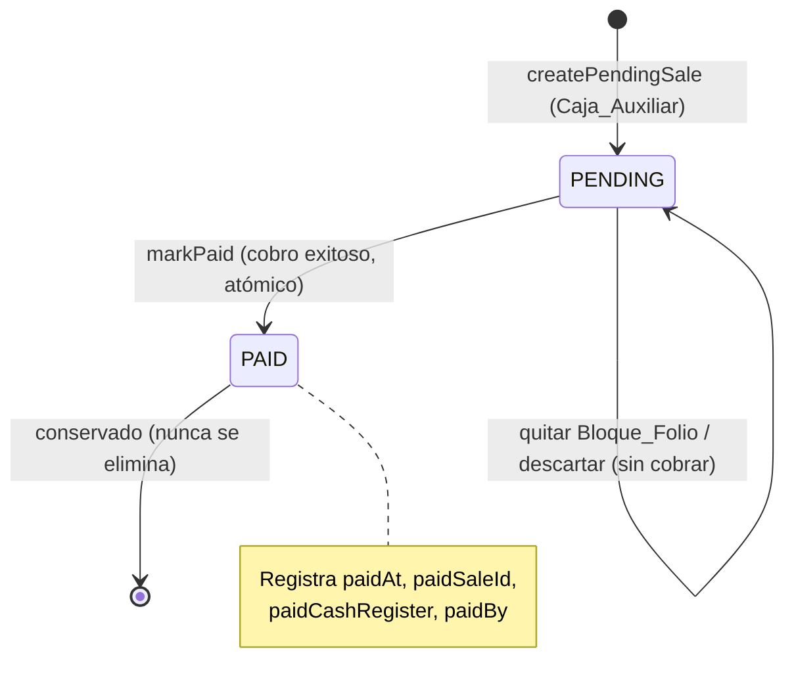

# Documento de Diseño

## Overview

Esta feature transforma la venta pendiente (`PendingSale`) de un registro efímero —que hoy se elimina al cargarse en la caja principal— en una **máquina de estados de dos estados** (`PENDING` → `PAID`) que se conserva en la base de datos durante todo su ciclo de vida. El cambio de estado a `PAID` ocurre únicamente al cobrar, de forma atómica, y vincula la `PendingSale` con la `Sale` real generada.

El diseño toca cuatro capas:

1. **Esquema de datos (Prisma)**: se extienden los modelos `PendingSale` y `Sale` con campos de estado y trazabilidad, todos opcionales o con valor por defecto, para no requerir migración de datos (Requisito 10).
2. **API de ventas pendientes (`pendingSalesController`)**: se añade el estado al crear, se expone el estado y la trazabilidad en las consultas, se incorpora filtrado por caja/estado, y se agrega una operación atómica para marcar como `PAID`.
3. **Flujo de cobro (`salesController` + `salesPage`)**: al cobrar una venta que contiene un folio, la `Sale` se crea con `origin = PENDING_SALE` y en la misma transacción se marca la `PendingSale` como `PAID`. Si el cobro falla, la `PendingSale` permanece `PENDING`.
4. **Frontend (React/Electron)**: la caja principal deja de eliminar el folio al cargarlo; lo carga como un **Bloque_Folio** inmutable. La caja auxiliar obtiene una **Vista_Mis_Folios** con semáforo 🟡/🟢, filtrada por la caja de origen leída de `localStorage`.

### Principio rector de la decisión de diseño

El problema de raíz es un **acoplamiento incorrecto entre "cargar" y "consumir"**: hoy el frontend trata la carga del folio como su consumo definitivo y lo borra. La solución separa esos dos momentos: *cargar* es un evento de solo lectura (el folio sigue `PENDING`), y *cobrar* es el único evento que consume el folio (lo pasa a `PAID`). La inmutabilidad del Bloque_Folio garantiza que lo cobrado coincida exactamente con lo que la auxiliar generó, eliminando la ambigüedad de entrega.

### Archivos afectados

| Capa | Archivo | Cambio |
|------|---------|--------|
| Datos | `mariam-pos-backend/prisma/schema.prisma` | Nuevos campos en `PendingSale` y `Sale` |
| API | `mariam-pos-backend/src/controllers/pendingSalesController.js` | Estado al crear, filtros, endpoint `markPaid`, dejar de depender de delete |
| API | `mariam-pos-backend/src/routes/pendingSales.js` | Ruta `PATCH /:id/pay` |
| API | `mariam-pos-backend/src/controllers/salesController.js` | Campos `origin`, `sourceCashRegister`, `onlineOrderId` al crear `Sale` |
| Front API | `mariam-pos-front/src/api/pendingSales.ts` | Tipos y función `markPendingSalePaid`, filtros en `getPendingSales` |
| Front UI | `mariam-pos-front/src/pages/sales/salesPage.tsx` | Bloque_Folio en el carrito; marcar `PAID` tras cobro |
| Front UI | `mariam-pos-front/src/pages/sales/PendingSalesModal.tsx` | Dejar de borrar al cargar; mostrar solo `PENDING` |
| Front UI | `mariam-pos-front/src/pages/sales/MyFoliosModal.tsx` (nuevo) | Vista_Mis_Folios con semáforo y polling |

## Architecture

### Máquina de estados de la Venta_Pendiente



Solo existe la transición `PENDING → PAID`. No hay transición inversa en esta feature: una vez cobrado, el folio queda cerrado. Cualquier intento de asignar un valor de estado fuera de `{PENDING, PAID}` se rechaza.

### Flujo de datos entre cajas (secuencia)

```mermaid
sequenceDiagram
    participant Aux as Caja_Auxiliar (app)
    participant API as API_Ventas_Pendientes
    participant DB as DB (Prisma/SQLite)
    participant Prin as Caja_Principal (salesPage)
    participant SaleAPI as API_Ventas (salesController)

    Aux->>API: POST /pending-sales (details, cashRegister, branch, createdBy)
    API->>DB: create PendingSale (status=PENDING)
    API-->>Aux: { code: "PP-1050", status: "PENDING" }

    Note over Prin: Más tarde, el cliente lleva el folio
    Prin->>API: GET /pending-sales?status=PENDING
    API-->>Prin: lista de folios PENDING
    Prin->>Prin: cargar folio como Bloque_Folio (NO borra)

    Prin->>SaleAPI: POST /sales (origin=PENDING_SALE, pendingSaleId, sourceCashRegister)
    SaleAPI->>DB: tx { create Sale; update PendingSale status=PAID + paid* }
    SaleAPI-->>Prin: { sale, pendingSale: PAID }

    loop Polling / refresco manual
        Aux->>API: GET /pending-sales?cashRegister=Caja 2
        API-->>Aux: folios con status (🟡/🟢)
    end
    Aux->>Aux: ve 🟢 PAID → entrega el contenido del folio
```

### Decisión clave: dónde vive la atomicidad del cobro

La atomicidad (Requisito 4.3 y 4.5) se resuelve en el **backend, dentro de `salesController.createSales`**, usando `prisma.$transaction`. El frontend envía en el mismo `POST /sales` los datos del folio (`pendingSaleId`, `sourceCashRegister`). El backend, en una única transacción:

1. Crea la `Sale` con `origin = PENDING_SALE`.
2. Actualiza la `PendingSale` a `status = PAID` con `paidSaleId = sale.id`, `paidAt`, `paidCashRegister`, `paidBy`.

Si cualquiera de las dos operaciones falla, la transacción revierte completa: no se crea venta huérfana y la `PendingSale` permanece `PENDING`.

**Alternativa descartada**: dos llamadas separadas del frontend (`createSale` y luego `markPaid`). Se descartó porque abre una ventana de inconsistencia (venta creada pero folio aún `PENDING`, o folio marcado `PAID` sin venta) si la segunda llamada falla o la red se corta. La transacción de servidor es la única forma de cumplir "de forma atómica en una única operación".

El endpoint `PATCH /pending-sales/:id/pay` se mantiene como API pública para casos de marcado manual/corrección, pero el flujo normal de cobro usa la transacción dentro de `createSales`.

## Components and Interfaces

### Backend — `pendingSalesController.js`

```js
// getPendingSales(req, res)
//   Query params opcionales:
//     - cashRegister: filtra por Caja_Origen (Req 8.2)
//     - status: filtra por Estado_Venta_Pendiente "PENDING" | "PAID" (Req 8.3)
//   Respuesta: incluye status, cashRegister, branch, createdBy,
//              paidAt, paidSaleId, paidCashRegister, paidBy (Req 8.1)

// createPendingSale(req, res)
//   Asigna status = "PENDING" (Req 1.2)
//   Registra cashRegister, branch, createdBy (Req 5.1)

// markPendingSalePaid(id, { saleId, paidCashRegister, paidBy }, tx?)
//   Función reutilizable. Valida transición y escribe paid* de forma atómica.
//   Si recibe `tx`, usa el cliente transaccional (llamada desde createSales).
//   Rechaza si el status solicitado no es válido (Req 1.4).
```

Validación de estado centralizada:

```js
export const PENDING_SALE_STATUSES = ["PENDING", "PAID"];

export function assertValidStatus(status) {
  if (!PENDING_SALE_STATUSES.includes(status)) {
    const err = new Error(`Estado de venta pendiente inválido: ${status}`);
    err.statusCode = 400;
    throw err;
  }
}
```

### Backend — rutas

```js
// routes/pendingSales.js
router.get("/", getPendingSales);        // ahora acepta ?cashRegister & ?status
router.get("/:id", getPendingSaleById);
router.post("/", createPendingSale);
router.delete("/:id", deletePendingSale); // se conserva (borrado manual explícito)
router.put("/:id", updatePendingSale);
router.patch("/:id/pay", markPendingSalePaidHandler); // nuevo (Req 4)
```

> **Nota sobre `deletePendingSale`**: el endpoint de borrado se conserva para el borrado manual explícito desde la vista (botón 🗑️). Lo que se elimina es la **llamada automática a `deletePendingSale` al cargar el folio** en `PendingSalesModal.handleSelect` (Req 2.1).

### Backend — `salesController.createSales`

```js
const { /* ...campos actuales... */,
        origin, sourceCashRegister, onlineOrderId,
        pendingSaleId, paidBy } = req.body;

const result = await prisma.$transaction(async (tx) => {
  const sale = await tx.sale.create({
    data: {
      /* ...campos actuales... */,
      origin: origin || "DIRECT",          // Req 9.2
      sourceCashRegister: sourceCashRegister || null,
      onlineOrderId: onlineOrderId || null, // Req 9.5
    },
    include: { details: true },
  });

  if (pendingSaleId) {                       // Req 4: hay Bloque_Folio
    await markPendingSalePaid(
      pendingSaleId,
      { saleId: sale.id, paidCashRegister: cashRegister, paidBy },
      tx
    );
  }
  return sale;
});
```

### Frontend — API (`pendingSales.ts`)

```ts
export type PendingSaleStatus = "PENDING" | "PAID";

export interface PendingSale {
  // ...campos actuales...
  status: PendingSaleStatus;
  createdBy?: string;
  paidAt?: string | null;
  paidSaleId?: number | null;
  paidCashRegister?: string | null;
  paidBy?: string | null;
}

export const getPendingSales = async (
  filters?: { cashRegister?: string; status?: PendingSaleStatus }
): Promise<PendingSale[]> => { /* arma query string */ };

export const markPendingSalePaid = async (
  id: number,
  payload: { saleId: number; paidCashRegister?: string; paidBy?: string }
): Promise<PendingSale> => { /* PATCH /pending-sales/:id/pay */ };
```

### Frontend — Bloque_Folio en el carrito (`salesPage.tsx`)

El carrito (`ItemCart extends Product`) se extiende con metadatos de bloque. Son opcionales: una línea sin ellos es un producto normal/extra.

```ts
interface ItemCart extends Product {
  // ...campos actuales (quantity, selectedPresentation, ...)...
  folioBlockId?: number;   // id de la PendingSale de origen; marca la línea como parte del Bloque_Folio
  folioCode?: string;      // código PP-NNNN para mostrar en el encabezado del bloque
  folioCashRegister?: string; // Caja_Origen a mostrar (Req 3.7)
}
```

Estado de folio cargado en la página:

```ts
const [loadedFolio, setLoadedFolio] = useState<{
  pendingSaleId: number;
  code: string;
  cashRegister?: string;
} | null>(null);
```

Reglas de interacción (Requisito 3):

- `handlePendingSaleSelect`: mapea los detalles a `ItemCart[]` marcados con `folioBlockId`, los agrega al carrito (sin borrar la `PendingSale`) y setea `loadedFolio`.
- `handleUpdateQuantity`, `handleRemove`, edición de precio: se vuelven **no-op** cuando la línea tiene `folioBlockId` definido (Req 3.2, 3.3). La UI oculta/deshabilita los controles de esas líneas.
- Nueva acción `handleRemoveFolioBlock()`: elimina todas las líneas con `folioBlockId === loadedFolio.pendingSaleId` y limpia `loadedFolio`, conservando los Productos_Extra (Req 3.5, 3.6). No toca la base de datos (la `PendingSale` sigue `PENDING`).
- Los Productos_Extra se agregan por el flujo normal (`handleAdd`) sin `folioBlockId` → editables (Req 3.4).

Al confirmar el pago (`confirmPayment`), si `loadedFolio` existe, se añaden al payload de `createSale`:

```ts
origin: loadedFolio ? "PENDING_SALE" : "DIRECT",
sourceCashRegister: loadedFolio?.cashRegister,
pendingSaleId: loadedFolio?.pendingSaleId,
paidBy: selectedCashier?.name,
```

Tras éxito, se limpia `loadedFolio` junto con el carrito.

### Frontend — `PendingSalesModal.tsx` (vista de carga de la Caja_Principal)

- `loadPendingSales`: llama `getPendingSales({ status: "PENDING" })` para listar solo folios cobrables (Req 8.4).
- `handleSelect`: **elimina** la llamada a `deletePendingSale`; solo invoca `onSelect(pendingSale)` (Req 2.1).

### Frontend — `MyFoliosModal.tsx` (Vista_Mis_Folios, nuevo)

Vista para la Caja_Auxiliar.

```ts
// Semáforo
const STATUS_BADGE: Record<PendingSaleStatus, string> = {
  PENDING: "🟡",
  PAID: "🟢",
};

// Filtrado por caja de origen (Req 7.2, 7.3)
const caja = localStorage.getItem("caja"); // Caja_Origen
// si !caja → render vacío, sin consultar otras cajas

// Carga
const load = () => getPendingSales({ cashRegister: caja });

// Refresco manual (Req 7.4) + polling simple (Req 7.5)
useEffect(() => {
  if (!caja || !autoRefresh) return;
  const t = setInterval(load, POLL_INTERVAL_MS); // p.ej. 15000
  return () => clearInterval(t);
}, [caja, autoRefresh]);
```

Cada fila muestra: semáforo, folio (`code`), estado, total y fecha de creación (Req 7.6). Reutiliza `PendingSaleDetailModal` para ver el detalle del folio (Req 6.3).

## Data Models

Todos los campos nuevos son **opcionales o con `@default`**, de modo que `prisma db push` no requiera migración de datos y los registros existentes queden válidos (Req 10.1–10.4). SQLite no tiene enums nativos de Prisma garantizados para todos los casos; para máxima compatibilidad y para que registros previos sin valor se interpreten por defecto, el estado y el origen se modelan como `String` con `@default`, y la validación del conjunto de valores se hace en la capa de API.

### `PendingSale` (extensión)

```prisma
model PendingSale {
  id           Int     @id @default(autoincrement())
  code         String  @unique
  clientName   String?
  total        Float
  branch       String? @default("Sucursal Default")
  cashRegister String? @default("Caja 1")

  // 🆕 Máquina de estados (Req 1, 10.4)
  status String @default("PENDING") // "PENDING" | "PAID"

  // 🆕 Trazabilidad de creación (Req 5.1)
  createdBy String?

  // 🆕 Trazabilidad de cobro (Req 4, 5.2, 5.3)
  paidAt           DateTime?
  paidSaleId       Int?      @unique
  paidCashRegister String?
  paidBy           String?

  details PendingSaleDetail[]

  createdAt DateTime @default(now())
  updatedAt DateTime @updatedAt

  @@index([code])
  @@index([clientName])
  @@index([createdAt])
  @@index([status])       // 🆕 filtro por estado (Req 8.3)
  @@index([cashRegister]) // 🆕 filtro por Caja_Origen (Req 8.2)
}
```

> `paidSaleId` es `Int?` y `@unique` (una venta real corresponde a lo sumo a un folio). No se declara una relación FK dura hacia `Sale` para no obligar a tocar el modelo `Sale` con back-relation y minimizar el riesgo con `db push`; la integridad referencial se garantiza en la transacción de cobro.

### `Sale` (extensión)

```prisma
model Sale {
  // ...campos actuales...

  // 🆕 Origen de venta (Req 9.1, 9.2, 10.3)
  origin String @default("DIRECT") // "DIRECT" | "PENDING_SALE" | "ONLINE"

  // 🆕 Caja de origen del folio cuando origin = PENDING_SALE (Req 9.4)
  sourceCashRegister String?

  // 🆕 Referencia opcional para pedidos en línea (Req 9.5)
  onlineOrderId String?

  // ...relaciones actuales...

  @@index([origin]) // 🆕 reportes futuros por origen
}
```

### Interpretación de valores por defecto (Req 10.3, 10.4)

- Un `PendingSale` previo sin `status` toma `PENDING` por el `@default`.
- Un `Sale` previo sin `origin` toma `DIRECT` por el `@default`.
- `prisma db push` añade las columnas con su default; los registros existentes conservan sus valores previos y reciben el default en las columnas nuevas.

### Aplicación del esquema (Req 10.5)

El cambio se aplica con:

```
npx prisma db push
```

**No** se usa `prisma migrate dev` (historial de migraciones no reproducible). La ejecución se realiza **solo tras confirmación explícita del usuario**. Antes de aplicar, se recomienda respaldar el archivo SQLite.

## Correctness Properties

*Una propiedad es una característica o comportamiento que debe cumplirse en todas las ejecuciones válidas del sistema: es una afirmación formal sobre lo que el sistema debe hacer. Las propiedades son el puente entre la especificación legible por humanos y las garantías de corrección verificables por máquina.*

El núcleo de esta feature —la máquina de estados, la atomicidad del cobro, el filtrado y las reglas de inmutabilidad del carrito— es lógica pura o casi pura, con un espacio de entradas amplio (carritos, conjuntos de folios, payloads de cobro). Esa parte es idónea para pruebas basadas en propiedades (PBT). Las partes de renderizado de UI, el polling con temporizadores y la aplicación del esquema (`prisma db push`) NO son adecuadas para PBT y se cubren con pruebas de ejemplo, de interacción y de integración (ver Testing Strategy).

Las siguientes propiedades se derivan del prework consolidado (se eliminó la redundancia entre criterios que expresan el mismo invariante).

### Property 1: Crear deja PENDING y registra trazabilidad

*Para todo* payload válido de creación de Venta_Pendiente (con `details` no vacío y valores arbitrarios de `clientName`, `branch`, `cashRegister`, `createdBy`), la Venta_Pendiente creada tiene `status === "PENDING"` y conserva `cashRegister`, `branch` y `createdBy` iguales a los del payload (o el valor por defecto documentado cuando el campo se omite).

**Validates: Requirements 1.2, 5.1**

### Property 2: El validador de estado rechaza valores inválidos

*Para todo* string `s`, `assertValidStatus(s)` (y la API que lo usa) acepta `s` si y solo si `s ∈ {"PENDING", "PAID"}`; para cualquier otro valor lanza/devuelve un error con código 400 y mensaje descriptivo.

**Validates: Requirements 1.1, 1.4**

### Property 3: Las operaciones sin cobro preservan PENDING y no eliminan

*Para toda* Venta_Pendiente en estado `PENDING`, aplicar cualquier operación distinta del cobro —cargar el folio al carrito, quitar el Bloque_Folio o descartar el folio— deja el registro persistido existente (no se elimina) y con `status === "PENDING"` sin cambios.

**Validates: Requirements 2.1, 2.2, 2.3, 3.6**

### Property 4: Un folio PENDING tiene todos los campos de cobro vacíos

*Para toda* Venta_Pendiente con `status === "PENDING"` (recién creada o tras operaciones sin cobro), los campos `paidAt`, `paidSaleId`, `paidCashRegister` y `paidBy` son nulos.

**Validates: Requirements 5.3**

### Property 5: Inmutabilidad de las líneas del Bloque_Folio

*Para todo* carrito que contenga líneas marcadas con `folioBlockId`, aplicar cualquier operación de edición (cambio de cantidad, cambio de precio, cambio de atributo) o de eliminación individual sobre una línea del bloque deja esa línea idéntica a su estado previo.

**Validates: Requirements 3.2, 3.3**

### Property 6: Los Productos_Extra permanecen editables

*Para todo* carrito, aplicar una operación de edición válida (cantidad o precio) sobre una línea que NO tiene `folioBlockId` produce el cambio solicitado en esa línea.

**Validates: Requirements 3.4**

### Property 7: Quitar el Bloque_Folio conserva exactamente los Productos_Extra

*Para todo* carrito compuesto por líneas de un Bloque_Folio y líneas extra, `removeFolioBlock(folioId)` produce un carrito que no contiene ninguna línea con ese `folioBlockId` y que es exactamente igual (contenido y orden) al subconjunto de líneas extra del carrito original.

**Validates: Requirements 3.5**

### Property 8: El cobro exitoso produce el post-estado atómico correcto

*Para todo* cobro exitoso de una venta que incluye un Bloque_Folio (es decir, con `pendingSaleId` presente), tras la transacción se cumple de forma conjunta: la Venta_Pendiente sigue existiendo con `status === "PAID"`; `paidSaleId` es igual al id de la Venta_Real creada; `paidCashRegister` es la caja que cobró; `paidBy` es el cajero que cobró; `paidAt` es no nulo; y la Venta_Real tiene `origin === "PENDING_SALE"` con `sourceCashRegister` igual a la Caja_Origen del folio.

**Validates: Requirements 1.3, 4.1, 4.2, 4.3, 4.4, 5.2, 9.3, 9.4**

### Property 9: El fallo del cobro revierte por completo

*Para todo* intento de cobro en el que la creación de la Venta_Real falla, tras la operación la Venta_Pendiente permanece con `status === "PENDING"`, sus campos `paidAt`, `paidSaleId`, `paidCashRegister` y `paidBy` siguen nulos, y no queda ninguna Venta_Real huérfana asociada.

**Validates: Requirements 4.5**

### Property 10: El detalle a entregar es el del folio y excluye los extras

*Para toda* Venta_Pendiente y todo conjunto de Productos_Extra agregados en la Caja_Principal, el detalle a entregar calculado por el sistema es exactamente el conjunto de `details` de la Venta_Pendiente y no incluye ninguna línea de Producto_Extra.

**Validates: Requirements 6.1, 6.2**

### Property 11: El filtrado es correcto y completo

*Para todo* conjunto de Ventas_Pendientes y todo filtro de igualdad sobre un campo (Caja_Origen o Estado_Venta_Pendiente), el resultado contiene todas y solo las ventas cuyo valor en ese campo coincide con el filtro. Cuando el filtro de Caja_Origen está vacío o ausente, el resultado es vacío (no se devuelven folios de otras cajas).

**Validates: Requirements 7.2, 7.3, 8.2, 8.3, 8.4**

### Property 12: La respuesta de la API expone estado y trazabilidad

*Para toda* Venta_Pendiente devuelta por `getPendingSales`, el objeto serializado expone las claves `status`, `cashRegister`, `branch`, `createdBy`, `paidAt`, `paidSaleId`, `paidCashRegister` y `paidBy`.

**Validates: Requirements 8.1**

### Property 13: Origen por defecto DIRECT al crear y al leer registros heredados

*Para todo* payload de creación de Venta_Real que no especifica `origin`, la venta creada tiene `origin === "DIRECT"`; y *para todo* registro de `Sale` o `PendingSale` heredado cuyo campo `origin` o `status` es nulo, la lectura lo interpreta como `"DIRECT"` y `"PENDING"` respectivamente.

**Validates: Requirements 9.2, 10.3, 10.4**

## Error Handling

| Escenario | Capa | Comportamiento |
|-----------|------|----------------|
| Estado solicitado fuera de `{PENDING, PAID}` | `pendingSalesController` | `assertValidStatus` lanza error 400 con mensaje descriptivo (Req 1.4). |
| Falla la creación de la Venta_Real durante el cobro | `salesController` (transacción) | `prisma.$transaction` revierte: no se crea Sale, la PendingSale queda `PENDING`, `paid*` nulos (Req 4.5). Se devuelve 500 con el error. |
| `markPaid` sobre una `PendingSale` inexistente | `pendingSalesController` | 404 "Venta pendiente no encontrada". |
| `markPaid` sobre un folio ya `PAID` | `pendingSalesController` | 409 "El folio ya fue cobrado" (idempotencia defensiva; evita doble cobro). |
| `localStorage.caja` ausente en Vista_Mis_Folios | `MyFoliosModal` | Render vacío, sin consultar la API con filtro de otra caja (Req 7.3). |
| Falla la consulta de folios (red/servidor) | `MyFoliosModal` / `PendingSalesModal` | Mensaje de error no intrusivo; se conserva la última lista mostrada; el polling reintenta en el siguiente ciclo. |
| Error de red al cobrar en el frontend | `salesPage.confirmPayment` | Se muestra el error; como la PendingSale no se tocó localmente, el folio sigue disponible para reintentar. |

Principio: ninguna ruta de error debe dejar un folio en estado ambiguo. Un folio solo pasa a `PAID` cuando existe una `Sale` real persistida que lo respalda.

## Testing Strategy

### Enfoque dual

- **Pruebas de ejemplo / unitarias**: casos concretos, interacciones de UI, renders y bordes específicos.
- **Pruebas basadas en propiedades (PBT)**: invariantes universales de la lógica de estado, atomicidad, filtrado e inmutabilidad del carrito.

Ambas son complementarias: las unitarias atrapan errores concretos; las de propiedades verifican la corrección general sobre un espacio amplio de entradas.

### Dónde aplica PBT y dónde no

**Aplica PBT** (lógica pura o testeable con mocks de Prisma):
- Validación de estado, transición y atomicidad del cobro (Properties 1–4, 8, 9, 13).
- Reglas de inmutabilidad y manipulación del carrito/Bloque_Folio (Properties 5–7, 10).
- Filtrado y forma de la respuesta de la API (Properties 11, 12).

**No aplica PBT** (se usan otras estrategias):
- Renderizado y apariencia del Bloque_Folio y del semáforo 🟡/🟢 (Req 3.1, 3.7, 7.1, 7.6): **render/snapshot tests** con React Testing Library.
- Interacción de refresco manual y polling con temporizadores (Req 7.4, 7.5): **pruebas de ejemplo con fake timers**.
- Apertura del detalle del folio (Req 6.3): **prueba de interacción de ejemplo**.
- Optatividad de `onlineOrderId` y campos nuevos (Req 9.5, 10.1): **aserciones de esquema / smoke**.
- Preservación de registros al aplicar `prisma db push` (Req 10.2): **prueba de integración** sobre una copia sembrada de la base SQLite (verificar conteos y valores antes/después).
- Aplicación del esquema vía `prisma db push` con confirmación del usuario (Req 10.5): **procedimiento documentado (runbook)**, sin prueba automatizada.

### Configuración de PBT

- **Librería**: se usa [`fast-check`](https://github.com/dubzzz/fast-check) (ecosistema JS/TS del proyecto); NO se implementa PBT desde cero.
- **Iteraciones**: mínimo **100** por propiedad (`fc.assert(..., { numRuns: 100 })`).
- **Aislamiento de Prisma**: las propiedades del backend usan un mock/stub del cliente Prisma (o una implementación en memoria) para ejercitar la lógica de transición/atomicidad sin costo de I/O; la atomicidad real (`$transaction`) se cubre además con 1–2 pruebas de integración.
- **Etiquetado**: cada prueba de propiedad referencia su propiedad del diseño con un comentario:
  - Formato: `// Feature: pending-sale-payment-status, Property {número}: {texto de la propiedad}`
- **Correspondencia**: cada propiedad de corrección se implementa con **una única** prueba basada en propiedades.

### Generadores previstos

- `arbPendingSaleCreatePayload`: `clientName` (string u omitido), `details` (array no vacío de detalles con `productId`, `quantity > 0`, `price >= 0`, presentación opcional), `branch`/`cashRegister`/`createdBy` arbitrarios u omitidos.
- `arbCart`: mezcla de líneas con `folioBlockId` (bloque) y sin él (extras), con cantidades/precios variados y orden arbitrario.
- `arbCobroInput`: `pendingSaleId` presente/ausente, caja y cajero arbitrarios; variante con fallo forzado en la creación de `Sale` para la Property 9.
- `arbFolioDataset` + `arbFilter`: conjunto de folios con `cashRegister`/`status` variados y un filtro de igualdad (incluyendo caja vacía/ausente) para la Property 11.
- `arbStatusString`: strings arbitrarios incluyendo los válidos, para la Property 2.

### Pruebas de ejemplo e integración mínimas

- Render del Bloque_Folio: muestra `code` y Caja_Origen; controles de edición/eliminación individual deshabilitados; botón "Quitar folio" presente.
- Semáforo: `PENDING → 🟡`, `PAID → 🟢`.
- Refresco: al pulsar refrescar, `getPendingSales` se vuelve a invocar y la fila refleja el nuevo estado.
- Integración de atomicidad: cobro real que crea `Sale` y marca `PendingSale` `PAID` en una transacción; y un caso con fallo inyectado que verifica el rollback (sin Sale, folio `PENDING`).
- Integración de compatibilidad: sobre una copia de la base, ejecutar `prisma db push` y verificar que `PendingSale` y `Sale` conservan sus filas y valores previos.
